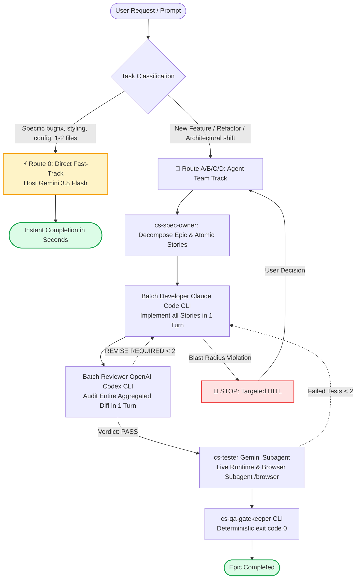

# CRAFT-SQUAD: AGENTS PROTOCOL & MONOREPO GUIDE

> **Agent-First Instruction & Architecture Guide** for AI Coding Assistants (Gemini, Claude Code CLI, OpenAI Codex CLI, Cursor) and Human Engineers working on or using **CraftSquad**.

---

## 1. Repository Identity & Architecture

CraftSquad is an engineering multi-agent team protocol, Antigravity plugin, and local management studio. It pairs **Claude Code CLI** (Full-Stack Developer & Architect), **OpenAI Codex CLI** (Adversarial Code Reviewer & UI Designer), and **Google Gemini** (Host Orchestrator, Spec Owner & E2E Tester).

```text
craft-squad/
├── plugin/                          # 📦 The official Antigravity Plugin
│   ├── agents/                      # Native Subagents (cs-spec-owner, cs-tester, etc.)
│   ├── bin/cli.js                   # CLI Dispatcher and Plugin Lifecycle Manager
│   ├── charters/                    # Explicit Role Charters (Developer, Reviewer, etc.)
│   ├── mcp-server/                  # Stdio MCP Server (squad_dispatch, squad_set_role)
│   ├── rules/AGENTS.md              # Always-on Dual-Track Triage & Batch Delivery Protocol
│   ├── templates/                   # Upstream BMAD-METHOD & GitHub Spec-Kit templates
│   ├── plugin.json                  # Antigravity Plugin Manifest (v3.1.0)
│   ├── package.json                 # Plugin NPM Package
│   └── squad.config.json            # Configuration-driven Role & Engine mapping
│
├── tool/                            # 🚀 Local Management Studio & CLI (Zero Dependencies)
│   ├── server.js                    # Native Node.js HTTP & REST API server (port 4200)
│   ├── bin/
│   │   └── cx.js                    # Standalone CLI tool for Codex profile switching
│   ├── lib/
│   │   ├── squad-manager.js         # Reads and updates squad.config.json
│   │   ├── codex-manager.js         # Built-in native Codex multi-account manager & sync engine
│   │   └── quota-monitor.js         # Multi-engine quota & auth inspector
│   └── public/                      # Modern Dark-Mode Dashboard (HTML5 / CSS3 / Vanilla JS)
│
├── package.json                     # Root Workspace Orchestrator (npm workspaces: plugin, tool)
├── .gitignore                       # Standardized Monorepo & Secrets Ignore Rules
└── AGENTS.md                        # Single Source of Truth for AI Agents & Developers
```

---

## 2. Universal Workspace Commands

All essential workflows can be executed directly from the repository root:

| Command | Action | Purpose |
|---|---|---|
| `npm start` / `npm run tool:start` | `node tool/server.js` | Launches the Local Management Studio at `http://localhost:4200` |
| `npm test` / `npm run plugin:test` | `npm --prefix plugin run test:dispatcher` | Runs the full 37-test offline verification suite |
| `npm run cx` | `node tool/bin/cx.js` | Standalone CLI for Codex profile switching & rotation |
| `npm run codex:list` | `node tool/bin/cx.js list` | Lists all registered Codex accounts, active profile, and token status |
| `npm run codex:rotate` | `node tool/bin/cx.js rotate` | Switches to the next valid account with least quota usage |
| `npm run codex:sync` | `node tool/bin/cx.js sync` | Bi-directional token synchronization (`Sync-on-Switch`) |
| `npm run codex:doctor` | `node tool/bin/cx.js doctor` | Diagnostics for Codex CLI, configs, and account health |
| `npm run plugin:install` | `node plugin/bin/cli.js install` | Stages and deploys clean plugin files into `~/.gemini/config/plugins/craft-squad` |
| `npm run plugin:update` / `plugin:upgrade` | `node plugin/bin/cli.js update` | Pulls latest git changes (`--no-pull` to skip) and redeploys the plugin |
| `npm run plugin:uninstall` | `node plugin/bin/cli.js uninstall` | Stops CraftSquad MCP server, removes plugin files, and cleans `config.json` |
| `npm run plugin:status` | `node plugin/bin/cli.js status` | Inspects CLI engines (Claude, Codex), models, and plugin paths |
| `npm run plugin:config` | `node plugin/bin/cli.js config` | Displays or updates role-engine mappings in `squad.config.json` |
| `npm run sync:upstream` | `node plugin/scripts/sync-upstream.js` | Fetches latest upstream BMAD-METHOD & GitHub Spec-Kit templates |

---

## 3. Cardinal Protocol: Dual-Track Triage & Batch Delivery

CraftSquad enforces a dual-track execution model to optimize speed and eliminate unnecessary multi-agent ceremony:



### Route 0: Direct Fast-Track (Host Agent Execution)
- **Applicable for**: Bugfixes with known cause, UI text/style adjustments, configuration changes, or explicit targeted modification prompts in 1–2 files.
- **Behavior**: Host Agent (Gemini 3.8 Flash) executes directly using file tools (`edit_file`, `write_file`) and verification commands. Bypasses external CLI startup overhead for instant turnaround.

### Route A/B/C/D: Agent Team Track (Batch Delivery Loop)
- **Applicable for**: New feature development, schema migrations, cross-cutting modules, or large-scale initiatives.
- **Single-Batch Delivery Discipline**:
  1. **Spec Owner (`cs-spec-owner`)**: Decomposes request into `EPIC-<ID>-<NAME>.md` and atomic `STORY-<ID>-<NAME>.md` files with strict `IN SCOPE`, `OUT OF SCOPE`, and `Blast Radius` boundaries.
  2. **Batch Developer (`claude` CLI)**: Dispatched once with `--epic=path/to/epic.md` to implement all constituent stories in a single turn.
  3. **Batch Reviewer (`codex` CLI)**: Dispatched once to audit the aggregate diff across all stories in a single turn.
  4. **E2E Tester (`cs-tester`)**: Executes end-to-end verification against live runtime servers, containers, or the `/browser` subagent.
  5. **QA Gatekeeper (`cli`)**: Runs deterministic test/build scripts requiring exit code 0.

---

## 4. Roles & Execution Routing Matrix

Engines, models, and reasoning effort are configured in `plugin/squad.config.json` and dynamically resolved at runtime by `squad_dispatch`.

| Role ID | Execution Method | Default Engine | Configured Model | Scope & Responsibilities | Constraints (Must NOT) |
|---|---|---|---|---|---|
| `spec_owner` | Isolated Subagent | `gemini` | `gemini-3.8-flash` | PRD, Epic breakdown (`EPIC-<ID>.md`), Stories (`STORY-<ID>.md`), Scope & Blast Radius | Choose tech stack, write code, violate blast radius |
| `scrum_master` | Host Agent / Subagent | `gemini` | `gemini-3.8-flash` | Triage (Route 0 vs Team Track), batch coordination, gatekeeper verification, HITL triggers | Write arbitrary feature code without review |
| `architect` | MCP Dispatch | `claude` | `sonnet` (effort: medium) | Technical blueprint, data models, schema deltas, API contracts | Write controllers/UI, expand blast radius without approval |
| `ui_designer` | MCP Dispatch | `codex` | `gpt-6.1-sol` (effort: medium) | Component decomposition (<150 lines), design tokens, UI layout skeletons | Add backend business logic or API calls |
| `developer` | MCP Dispatch | `claude` | `sonnet` (effort: medium) | Full implementation within Story/Epic `OUTPUT` boundaries | Edit unassigned files, change tokens/contracts, self-approve |
| `code_reviewer` | MCP Dispatch | `codex` | `gpt-6.1-sol` (effort: medium) | Adversarial audit, blast radius verification, file length limits | Edit feature source code |
| `tester` | Isolated Subagent | `gemini` | `gemini-3.8-flash` | Live runtime verification (Docker / localhost), Browser Subagent journeys | Report mocked passes, modify source code to pass tests |
| `qa_gatekeeper` | MCP Dispatch / CLI | `cli` | `npm test` | Deterministic build/test execution; exit code 0 | Accept prose or warnings instead of clean exit code |
| `rescue` | MCP Dispatch | `codex` | `gpt-6.1-sol` (effort: medium) | Root-cause isolation when a delivery loop fails >= 2 cycles | Widen scope beyond the breaking failure |

---

## 5. The 4 Targeted HITL (Human-in-the-Loop) Triggers

Autonomous progression halts and requires explicit user confirmation ONLY when:

1. **Trigger 1 (Major Architecture Decision)**: Two or more competing architectural patterns affecting shared schemas, core ledgers, or breaking existing contracts.
2. **Trigger 2 (Core UX Divergence)**: Interaction model radically deviates from existing project design tokens or layout structure.
3. **Trigger 3 (Blast Radius Violation)**: Implementing a Story requires modifying files outside its approved `OUTPUT` or beyond allowed directory boundaries.
4. **Trigger 4 (Review Deadlock / Stuck Loop)**: Reviewer returns `REVISE REQUIRED` twice, or test verification fails >= 2 cycles.

---

## 6. Local Studio & Codex Multi-Account Engine (`tool/`)

The `tool/` directory contains a zero-dependency web studio and account switcher:
- **Zero External Dependencies**: Built entirely with native Node.js core modules (`http`, `fs`, `path`, `crypto`, `child_process`). Do not introduce npm dependencies (e.g. Express, Axios).
- **Web Dashboard**: Runs at port 4200 (`node tool/server.js`) offering:
  - Role-to-model configuration editor (`tool/lib/squad-manager.js`).
  - Native Codex multi-account switcher (`tool/lib/codex-manager.js`).
  - Multi-engine Quota & Auth health monitor (`tool/lib/quota-monitor.js`).
- **Codex Switcher CLI (`tool/bin/cx.js`)**:
  - `cx list`: Displays accounts, current active profile, and token expiry.
  - `cx rotate`: Rotates to the next optimal account automatically.
  - `cx switch <name>`: Switches active account with bi-directional token sync.
  - `cx sync`: Saves current live tokens to the profile storage safely.
  - `cx doctor`: Validates `~/.codex/` directory structure and CLI availability.

---

## 7. Engineering Standards for Agents Working on this Repo

When developing, refactoring, or extending CraftSquad itself:

1. **Zero External Dependencies Mandate**:
   - `tool/` must remain dependency-free (vanilla Node.js backend, vanilla HTML/CSS/JS frontend in `tool/public/`).
   - `plugin/` must remain dependency-free (native stdio RPC MCP server, native CLI execution).
2. **Safe Atomic Operations**:
   - Updates to configuration files (`squad.config.json`) or auth tokens (`~/.codex/auth.json`) must use atomic file write-and-rename semantics (`fs.writeFileSync(tmpPath)` -> `fs.renameSync(tmpPath, targetPath)`).
3. **Modularity & File Length Discipline**:
   - Keep individual modules focused and concise (<350 lines per file where practical).
   - Decompose complex functionality into dedicated modules under `tool/lib/` or `plugin/mcp-server/modules/`.
4. **Verification Gate**:
   - Prior to marking any task as complete, always run:
     ```bash
     npm test
     ```
   - All unit tests in `plugin/scripts/test_dispatcher.js` (37 tests) must PASS cleanly.
