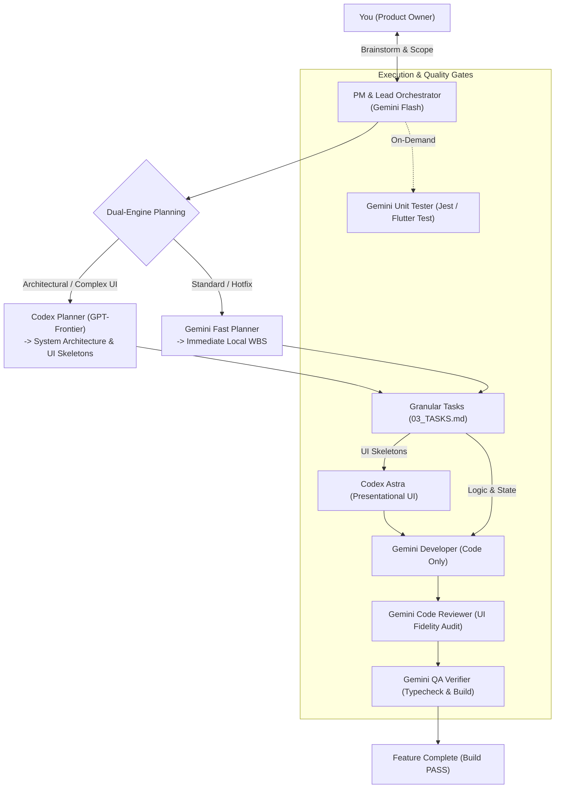

# CraftSquad 🚀

> **Autonomous multi-agent orchestration system for Antigravity and Codex across Web & Mobile.**  
> Built for zero-API-cost hybrid workflows, dual-engine planning, granular task delegation, and mobile-remote developer operation.

---

## 🌟 Key Highlights

* **Zero Extra API Cost:** Leverages your existing personal subscriptions (Antigravity Gemini Flash + Codex Plus Astra) without pay-per-token API keys.
* **Dual-Engine Planning:** Dynamic planning engine selection—routes high-reasoning architectural problems to Codex (GPT-Frontier) and fast localized plans to Gemini Flash.
* **Granular Task Delegation:** Breaks features into discrete tasks assigned by model capability (Codex for UI/UX skeletons & algorithms; Gemini for implementation, code review, and build QA).
* **Cross-Platform by Design:** Full support for both **Web (Next.js/Tailwind)** and **Mobile (Flutter, React Native/Expo)** with native ergonomic standards (touch targets $\ge 48\text{dp}$, safe area insets).
* **Mobile-Remote Friendly:** Designed to be operated from your phone browser and mobile app:
  * Single persistent thread per tool—zero chat clutter.
  * Zero-branch-hopping concurrency—no accidental physical collisions on disk.
  * Push alerts via webhook (`ntfy.sh`) when handoffs are ready.

---

## 👥 Multi-Agent Roles & Specialization

CraftSquad orchestrates specialized agent roles with strict operational boundaries:



| Role | Engine | Primary Focus | Boundary |
|---|---|---|---|
| **PM & Orchestrator** | Gemini Flash | Intake, scope freezing, complexity classification, pipeline routing. | Does not code directly. |
| **Lead UX/UI Designer** | **Codex Astra** | Cross-platform visual design, layout wireframes, Tailwind/Flutter skeletons. | **Presentational UI only.** Does not write backend/APIs. |
| **Software Developer** | Gemini Flash | Business logic, state management, API wiring, container components. | **CODE ONLY.** Never runs builds, tests, or unit tests. |
| **Code Reviewer** | Gemini Flash | Audits diff against PRD and UI Spec, UI fidelity checks, clean code. | Outputs PASS or REVISE verdicts only. |
| **QA Build Verifier** | Gemini Flash | Build & compilation gatekeeper (`tsc`, `npm run build`, `flutter analyze`). | Ensures exit code 0. |
| **Unit Test Engineer** | Gemini Flash | Authors unit tests and executes test runners on-demand. | Only active when `needs_unit_tests: true`. |

---

## ⚡ Granular Task Delegation in Action

Each task in `03_TASKS.md` is tagged with its optimal executor:

```markdown
- [ ] Task 1: [DELEGATE: CODEX-UI] Presentational Component Skeletons (Flutter Widget / React JSX)
- [ ] Task 2: [DELEGATE: CODEX-LOGIC] High-complexity business algorithms & state specs
- [ ] Task 3: [DELEGATE: GEMINI-DEV] State wiring, API integration, form validation (Code only)
- [ ] Task 4: [DELEGATE: GEMINI-REVIEW] Code review auditing implementation against UI Spec
- [ ] Task 5: [DELEGATE: GEMINI-QA] Verification, typechecking, and build compilation
- [ ] Task 6: [DELEGATE: GEMINI-UNIT-TEST] (On-Demand) Unit test authoring and execution
```

---

## 📂 Repository Structure

```text
craft-squad/
├── bin/
│   └── cli.js                     # CLI installer (npx craft-squad init)
├── scripts/
│   └── watcher.js                 # Recursive file watcher for auto-handoff detection
├── templates/
│   ├── plugin.json                # Antigravity plugin manifest
│   ├── rules/
│   │   └── AGENTS.md              # Multi-agent protocol & concurrency rules
│   ├── skills/                    # Specialized agent runbooks
│   │   ├── pm-orchestrator/
│   │   ├── architect-router/
│   │   ├── dev-executor/
│   │   ├── code-reviewer/
│   │   ├── qa-verifier/           # Cross-platform: Web, Flutter, React Native
│   │   └── unit-tester/
│   └── project-scaffold/          # Scaffold copied into project's .agents/
│       ├── STATE.json             # Root state index
│       ├── features/
│       │   └── sample-feature/    # Isolated feature workspace
│       │       ├── 01_PRD.md
│       │       ├── 02_UI_SPEC.md
│       │       ├── 03_TASKS.md
│       │       └── STATE.json
│       ├── HANDOFF_TO_ASTRA.md
│       ├── HANDOFF_TO_CODEX_PLANNER.md
│       ├── HANDOFF_TO_CHATGPT.md
│       └── git-hooks/
│           └── post-commit        # Automatic Git-driven state transitions & push alerts
├── package.json
└── README.md
```

---

## 🚀 Quick Start

Initialize CraftSquad in any project repository:

```bash
npx craft-squad init
```

### Daily Workflow:
1. **On your phone, open Antigravity:** Maintain a single persistent conversation with the PM agent.
2. **On your phone, open Codex:** Maintain a single persistent conversation for UX/UI & architecture handoffs.
3. **Run concurrently with confidence:** Feature namespaces (`.agents/features/<slug>/` and `src/features/<slug>/`) ensure parallel tasks never collide physically on disk.
