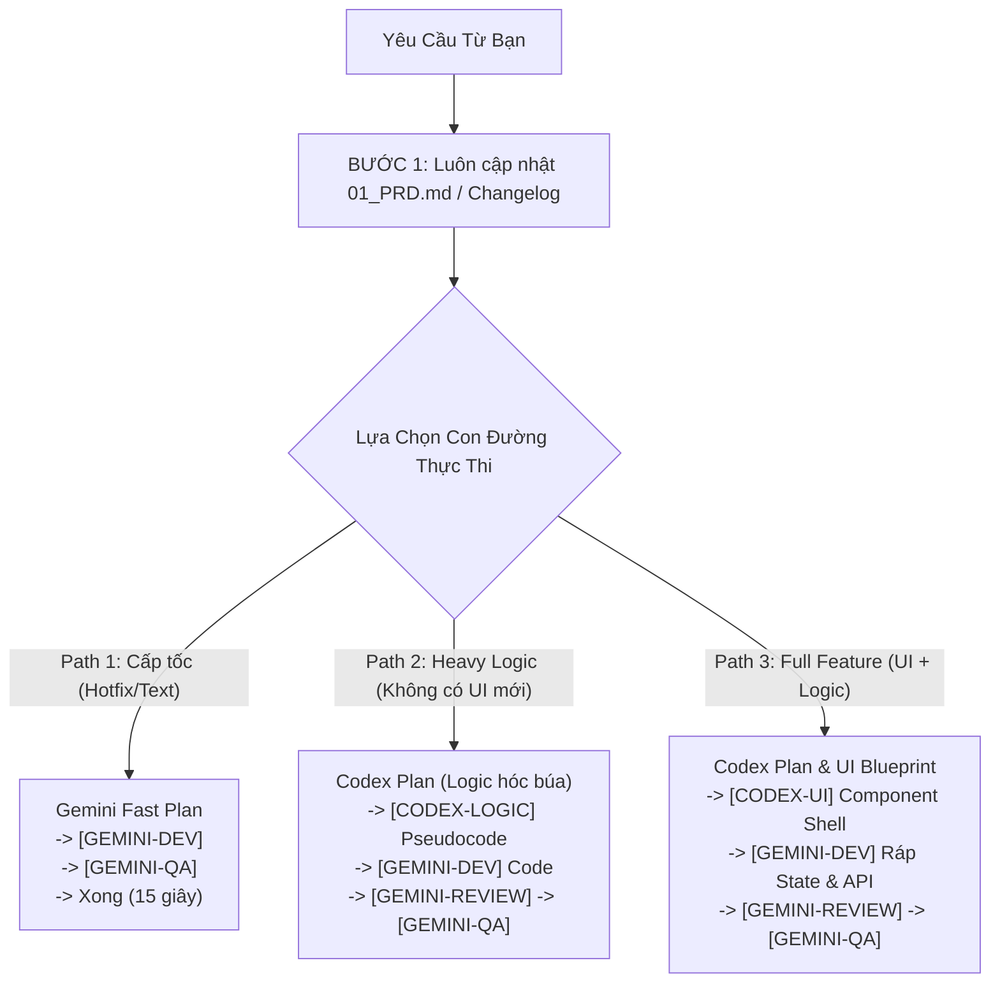

# CraftXTech Multi-Agent Orchestrator Kit 🚀

> **Hệ thống điều phối đội ngũ 6 AI Agent chuyên nghiệp (PM, UX/UI Designer, Developer, Code Reviewer, QA Verifier, Unit Tester).**  
> Kết hợp mô hình **Dual-Engine Planning** (Lập kế hoạch 2 tầng giữa Codex và Gemini) và **Granular Task Delegation** (Phân bổ công việc chi tiết theo từng dòng task).

---

## 🎯 2 Trụ Cột Kiến Trúc Cốt Lõi

### 1. Nguyên Tắc Bất Biến: Mọi Task Đều Phải Có Plan (Universal Planning)
* Tuyệt đối không có commit "chui" không vết tích.
* Dù là sửa 1 chữ text hay 1 class CSS (Hotfix), hệ thống đều ghi nhận vào `.agents/features/<slug>/01_PRD.md` (mục Changelog) và tạo 1 task rõ ràng trong `03_TASKS.md`. Đảm bảo 100% khả năng truy vết (Traceability).

### 2. Dual-Engine Planning: AI Nào Sẽ Lập Kế Hoạch?
* **Codex (GPT-Frontier) Planner:** Dùng cho bài toán trừu tượng cao, kiến trúc hệ thống mới, luồng dữ liệu đa tầng hoặc thiết kế giao diện lớn từ đầu.
* **Gemini Flash Planner:** Dùng cho các bài toán rõ ràng, theo khuôn mẫu, CRUD hoặc bugfix cục bộ. Thực hiện tức thì trong 2 giây, không tốn bước copy-paste.

---

## 👥 Phân Bổ Nhiệm Vụ Chi Tiết (Granular Task Delegation)

Trong file `03_TASKS.md`, từng task được gắn thẻ rõ ràng cho đúng model:

```markdown
- [ ] Task 1: [DELEGATE: CODEX-UI] Xuất Presentational Component JSX & Tailwind
- [ ] Task 2: [DELEGATE: CODEX-LOGIC] Thuật toán tính toán nghiệp vụ phức tạp
- [ ] Task 3: [DELEGATE: GEMINI-DEV] Lắp ráp State, kết nối API, Form validation
- [ ] Task 4: [DELEGATE: GEMINI-REVIEW] Code Review & UI Audit đối chiếu với Spec
- [ ] Task 5: [DELEGATE: GEMINI-QA] Build & Typecheck (tsc --noEmit, build)
- [ ] Task 6: [DELEGATE: GEMINI-UNIT-TEST] (On-Demand) Viết Unit Test nếu có yêu cầu
```

---

## ⚡ 3 Con Đường Thực Thi Linh Hoạt (Flexible Paths)



---

## 📂 Cấu Trúc Repo

```text
craftxtech-agent/
├── bin/
│   └── cli.js                     # CLI cài đặt tự động (npx craftxtech-agent init)
├── scripts/
│   └── watcher.js                 # File watcher đệ quy đa tính năng
├── templates/
│   ├── plugin.json                # Manifest Plugin
│   ├── rules/
│   │   └── AGENTS.md              # Bộ quy tắc Dual-Engine & Task Delegation
│   ├── skills/                    # 6 Skills chuyên trách
│   │   ├── pm-orchestrator/
│   │   ├── architect-router/
│   │   ├── dev-executor/
│   │   ├── code-reviewer/
│   │   ├── qa-verifier/
│   │   └── unit-tester/
│   └── project-scaffold/          # Bộ khung .agents/ đặt trong dự án
│       ├── STATE.json
│       ├── features/
│       │   └── sample-feature/
│       │       ├── 01_PRD.md
│       │       ├── 02_UI_SPEC.md
│       │       ├── 03_TASKS.md
│       │       └── STATE.json
│       ├── HANDOFF_TO_ASTRA.md
│       ├── HANDOFF_TO_CODEX_PLANNER.md
│       ├── HANDOFF_TO_CHATGPT.md
│       └── git-hooks/
│           └── post-commit
├── package.json
└── README.md
```

---

## 🚀 Cài Đặt và Sử Dụng

```bash
npx craftxtech-agent init
```
1. Mở Antigravity trên điện thoại (Thread 1) để tương tác với PM.
2. Mở Codex trên điện thoại (Thread 2) để nhận các task `[DELEGATE: CODEX-...]`.
3. Mọi công việc cày cuốc code, review, test và build do Gemini Flash tự động xử lý!
