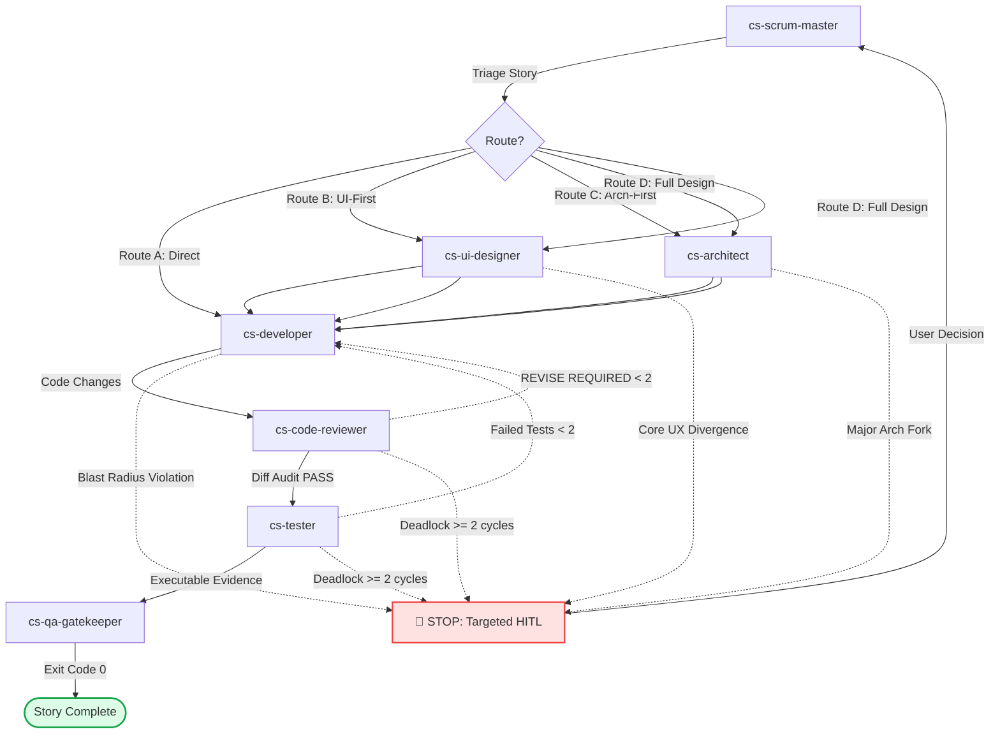

# CraftSquad: Role-Based Autonomous Agent Team for Antigravity

**CraftSquad** is an engineering agent team protocol and plugin for Google Antigravity. It structures complex initiatives into lean **Epics** and atomic **Stories**, orchestrates specialized **Native Subagents**, enforces deterministic **Quality Gates**, and incorporates **Targeted Human-in-the-Loop (HITL)** safeguards.

Engines, models, and reasoning effort are configuration-driven (`squad.config.json`) and resolved at runtime. Personas and review methodologies are derived from [BMAD-METHOD](https://github.com/bmad-code-org/BMAD-METHOD); specifications and task templates follow [GitHub Spec-Kit](https://github.com/github/spec-kit).

---

## 1. Native Subagents & Roles

CraftSquad ships dedicated, isolated Native Subagents located in `agents/` (100% Native Subagents without legacy skills):

| Role ID | Subagent Manifest | Default Engine / Model | Responsibilities & Boundaries |
|---|---|---|---|
| `spec_owner` | `agents/cs-spec-owner.md` | `gemini` (`gemini-3.8-flash`) | Decomposes briefs into Epics (`EPIC-<ID>-<NAME>.md`) and Stories with explicit `IN/OUT SCOPE` and `Blast Radius`. |
| `scrum_master` | `agents/cs-scrum-master.md` | `gemini` (`gemini-3.8-flash`) | Triages Stories, coordinates Subagent handoffs, enforces Quality Gates, and triggers Targeted HITL. |
| `architect` | `agents/cs-architect.md` | `claude` (`sonnet`) | Produces minimal data models, SQL migration deltas, and API validation contracts within Story scope. |
| `ui_designer` | `agents/cs-ui-designer.md` | `codex` (`gpt-6.1-sol`) | Decomposes views into subcomponents (<150 lines), establishes design tokens, eliminates AI UI slop. |
| `developer` | `agents/cs-developer.md` | `claude` (`sonnet`) | Implements backend logic and frontend state strictly within the Story's `OUTPUT` file list. |
| `code_reviewer` | `agents/cs-code-reviewer.md` | `codex` (`gpt-6.1-sol`) | Adversarial diff audit for blast-radius violations, file length limits (<350 lines), and edge cases. |
| `tester` | `agents/cs-tester.md` | `gemini` (`gemini-3.8-flash`) | Reads project `AGENTS.md`, executes live verification on runtime (Docker / localhost), captures proof. |
| `qa_gatekeeper` | `charters/qa_gatekeeper.md` | `cli` (e.g. `npm test`) | Runs deterministic typecheck and build command; exit code 0 is the only pass. |
| `rescue` | `agents/cs-rescue.md` | `codex` (`gpt-6.1-sol`) | Root-cause analysis and minimal targeted fixes when a Story loop fails >= 2 cycles. |

---

## 2. Work Breakdown: Epic & Story Protocol (No Sprints)

To prevent scope creep and bloated context, CraftSquad abandons multi-week sprint ceremonies in favor of lean, deliverable units:

1. **Epic Structure (`docs/epics/EPIC-<ID>-<NAME>.md`)**:
   - **Objective**: Core business purpose.
   - **Scope Boundaries**: Explicit `IN SCOPE` vs `OUT OF SCOPE` (strictly prevents AI hallucinations and feature creep).
   - **Blast Radius**: Explicit list of allowed directories/modules. Modifications outside this list are forbidden.
   - **Story List**: Ordered atomic stories.
2. **Story Structure (`docs/epics/stories/STORY-<ID>-<NAME>.md`)**:
   - **INPUT**: Prerequisite schemas, contracts, tokens.
   - **OUTPUT**: Exact list of files to create/modify and endpoints/components exported.
   - **ACCEPTANCE CRITERIA**: Concrete `Given - When - Then` criteria.
   - **VERIFICATION METHOD**: Execution commands or Browser Subagent scenarios.

Template files are available in `templates/craftsquad/epic-template.md` and `templates/craftsquad/story-template.md`.

---

## 3. Delivery Workflow & Targeted HITL Safeguards



### Autonomous Gates
By default, the Agent Team progresses autonomously through Gates 1 to 4 as long as contracts are respected, diff checks pass, and tests succeed.

### The 4 Targeted HITL Triggers (Must Stop and Ask User)
1. **Trigger 1 (Major Architecture Decision)**: 2+ competing architectural solutions affecting shared schema, core ledger, or breaking data models.
2. **Trigger 2 (Core UX Divergence)**: Interaction model radically deviates from existing project layout patterns.
3. **Trigger 3 (Blast Radius Violation)**: Implementing a Story requires modifying files outside its approved `OUTPUT` or beyond allowed modules.
4. **Trigger 4 (Review Deadlock / Stuck Loop)**: Reviewer returns `REVISE REQUIRED` twice, or test verification fails >= 2 cycles.

---

## 4. Quản Lý Vòng Đời Plugin (Cài Đặt, Nâng Cấp, Gỡ Bỏ)

CraftSquad cung cấp các lệnh CLI và npm scripts để quản lý toàn diện vòng đời plugin:

### A. Kiểm tra trạng thái hệ thống (Health Check / Doctor)
Kiểm tra kết nối của Codex CLI, Claude Code CLI, cấu hình models, và đường dẫn plugin:
```bash
node bin/cli.js status
# Hoặc
npm run status
```

### B. Cài đặt Plugin vào Antigravity (Install)
Lệnh này sẽ tạo một **Directory Junction (Symbolic Link)** từ repository mã nguồn này tới thư mục plugin toàn cục của Antigravity (`~/.gemini/config/plugins/craft-squad`).
> [!TIP]
> Sử dụng Junction Link giúp **mọi thay đổi mã nguồn trong repository này có hiệu lực ngay lập tức** trong Antigravity mà không cần copy file thủ công!

```bash
node bin/cli.js install
# Hoặc
npm run plugin:install
```

### C. Nâng cấp Plugin (Upgrade)
Cập nhật lại các mẫu template từ upstream BMAD và Spec-Kit, đồng thời làm mới liên kết plugin:
```bash
node bin/cli.js upgrade
# Hoặc
npm run plugin:upgrade
```

### D. Hủy bỏ / Gỡ bỏ Plugin (Uninstall)
Xóa an toàn liên kết Junction hoặc thư mục plugin khỏi Antigravity:
```bash
node bin/cli.js uninstall
# Hoặc
npm run plugin:uninstall
```

### E. Khởi tạo trong một dự án phần mềm mới (Init)
Để áp dụng CraftSquad cho một repository khác:
```bash
cd /path/to/my-project
node /path/to/craft-squad/bin/cli.js init
```
Lệnh này sẽ sao chép `squad.config.json` và `squad.schema.json` vào thư mục gốc của dự án để tùy biến model và lệnh build riêng.

---

## 5. Cấu Hình Engines & Models (`squad.config.json`)

Mỗi vai trò có thể được gán một Engine (`claude`, `codex`, `gemini`, `cli`) và Model độc lập:

```bash
# Xem cấu hình hiện tại
node bin/cli.js config

# Thay đổi model hoặc engine cho một vai trò
node bin/cli.js config set developer claude sonnet medium
node bin/cli.js config set code_reviewer codex gpt-6.1-sol high
node bin/cli.js config set architect claude sonnet high
```

- **Timeout**: Mặc định là `600s` (10 phút) để đảm bảo các CLI engine có đủ thời gian xử lý mà không bị ngắt kết nối RPC.
- **Cross-Engine Adversarial Rule**: Code Reviewer nên chạy trên engine khác với Developer để tối đa hóa tính độc lập khi phản biện.

---

## 6. Kiểm Thử Hệ Thống (Test Suite)

Chạy bộ kiểm thử tự động của CraftSquad (offline verification, kiểm tra schema, toml parser, prompt compiler, routing):
```bash
npm run test:dispatcher
```
