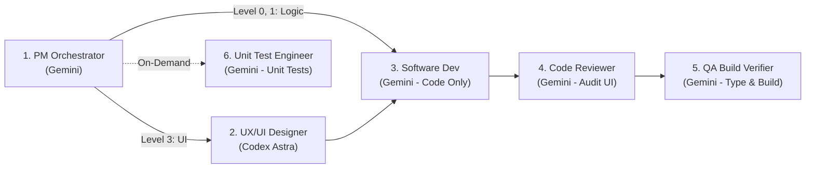

# CraftXTech Multi-Agent Orchestrator Kit 🚀

> **Hệ thống điều phối đội ngũ 6 AI Agent chuyên nghiệp (PM, UX/UI Designer, Developer, Code Reviewer, QA Verifier, Unit Tester).**  
> Tối ưu hóa 100% token bằng mô hình phân quyền chặt chẽ, hỗ trợ chạy song song không xung đột vật lý và thích ứng linh hoạt theo độ phức tạp của từng task.

---

## 👥 Đội Ngũ 6 Role Chuyên Biệt (Software Engineering Team)

Mỗi Agent có một **Trách nhiệm duy nhất (Single Responsibility)** và **Ranh giới bất khả xâm phạm**:



| Role | Model | Trách nhiệm | Ranh giới nghiêm ngặt |
|---|:---:|---|---|
| **1. PM & Orchestrator** | Gemini Flash | Brainstorm, khóa yêu cầu, đánh giá độ phức tạp, điều phối pipeline. | Không viết code trực tiếp. |
| **2. Lead UX/UI Designer** | **Codex Astra** | Thiết kế bộ mặt sản phẩm, Tailwind tokens, Component Skeletons (Presentational UI). | **Dùng 1 lần duy nhất cho UI** (Tiết kiệm quota). Không làm backend. |
| **3. Software Developer** | Gemini Flash | Lắp "động cơ" logic: state, API fetch, form handling, routing. | **CHỈ VIẾT CODE:** Tuyệt đối không tự chạy build, không tự chạy test, không viết unit test. |
| **4. Code Reviewer** | Gemini Flash | Soát lỗi code, kiểm tra tính trung thực với UI Spec của Astra, bảo mật, clean code. | Không viết code tính năng; ra phán quyết PASS hoặc REVISE. |
| **5. QA Build Verifier** | Gemini Flash | Chạy kiểm tra biên dịch: `tsc --noEmit`, `npm run lint`, `npm run build`. | Không sáng tạo tính năng; tập trung đảm bảo build xanh 100%. |
| **6. Unit Test Engineer** | Gemini Flash | Viết các bài test logic (`*.test.ts`) và chạy `npm test`. | **CHỈ CHẠY KHI CÓ YÊU CẦU** (`needs_unit_tests: true`). |

---

## ⚡ Điều Phối Động Theo Độ Phức Tạp (Dynamic Adaptive Pipeline)

Hệ thống **KHÔNG** bắt ép mọi task nhỏ phải chạy qua toàn bộ 6 Agent. Agent PM sẽ tự động phân loại để tiết kiệm thời gian và token:

* **Level 0: Micro / Hotfix (Sửa text, đổi 1 class CSS, sửa lỗi chính tả):**
  $$\text{User} \rightarrow \text{Developer} \rightarrow \text{QA Verifier} \rightarrow \text{Xong}$$
  *(Bỏ qua Astra, Reviewer và Unit Tester để xử lý nhanh nhất).*

* **Level 1: Logic / Backend / CRUD (Không thay đổi UI lớn):**
  $$\text{User} \rightarrow \text{PM} \rightarrow \text{Developer} \rightarrow \text{Code Reviewer} \rightarrow \text{QA Verifier}$$

* **Level 2: Visual Decor (Cần ảnh banner, minh họa):**
  $$\text{User} \rightarrow \text{ChatGPT (DALL-E 3)} \rightarrow \text{Developer} \rightarrow \text{QA Verifier}$$

* **Level 3: Major Feature / Giao diện mới phức tạp:**
  $$\text{User} \rightarrow \text{PM} \rightarrow \text{Codex Astra (UX/UI)} \rightarrow \text{Developer} \rightarrow \text{Code Reviewer} \rightarrow \text{QA Verifier} \rightarrow \text{(Unit Tester)}$$

---

## 📂 Cấu Trúc Repo

```text
craftxtech-agent/
├── bin/
│   └── cli.js                     # CLI cài đặt tự động (npx craftxtech-agent init)
├── scripts/
│   └── watcher.js                 # File watcher đệ quy tự động phát hiện Astra/PM ghi file
├── templates/
│   ├── plugin.json                # Manifest Global Plugin
│   ├── rules/
│   │   └── AGENTS.md              # Bộ quy tắc 6 Role, Concurrency & Git Convention
│   ├── skills/                    # 6 Skills tương ứng 6 vai trò
│   │   ├── pm-orchestrator/
│   │   ├── architect-router/
│   │   ├── dev-executor/
│   │   ├── code-reviewer/
│   │   ├── qa-verifier/
│   │   └── unit-tester/
│   └── project-scaffold/          # Bộ khung .agents/ cho dự án
│       ├── STATE.json
│       ├── features/
│       │   └── sample-feature/
│       │       ├── 01_PRD.md
│       │       ├── 02_UI_SPEC.md
│       │       ├── 03_TASKS.md
│       │       └── STATE.json
│       ├── HANDOFF_TO_ASTRA.md
│       ├── HANDOFF_TO_CHATGPT.md
│       └── git-hooks/
│           └── post-commit        # Git Hook tự động đồng bộ & push notification
├── package.json
└── README.md
```

---

## 🚀 Cài Đặt và Sử Dụng

Sau khi publish lên npm, ở bất kỳ dự án nào bạn chỉ cần chạy:
```bash
npx craftxtech-agent init
```
1. Giữ **1 Thread chat Antigravity** cho PM & Core Team.
2. Giữ **1 Thread chat Codex** cho UX/UI Designer (Astra).
3. PM sẽ tự động nhận định task lớn hay nhỏ để kích hoạt đúng số lượng Agent cần thiết!
