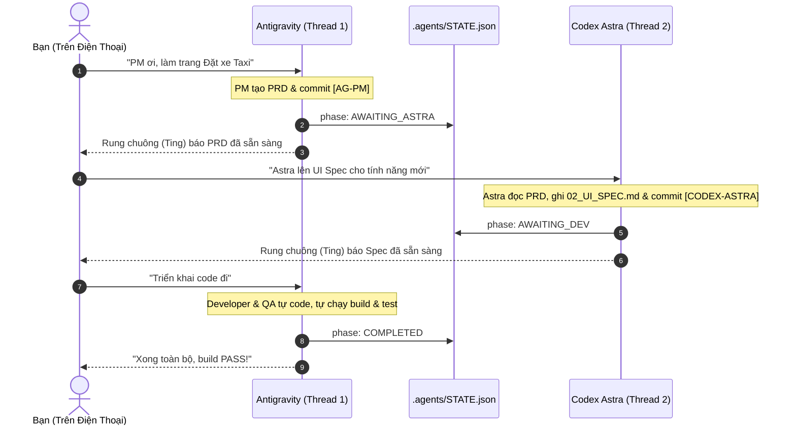

# CraftXTech Multi-Agent Orchestrator Kit 🚀

> **Hệ thống điều phối đội ngũ AI Agent (PM, Astra Architect, Gemini Developer, QA Verifier) dành cho Antigravity 2.0 và Codex.**  
> Tối ưu hóa 100% cho việc điều khiển từ xa qua điện thoại (Mobile Remote), không tốn chi phí API, không phát sinh chat rác và loại bỏ hoàn toàn việc copy-paste thủ công.

---

## 💡 Triết Lý Thiết Kế

1. **Zero API Key Cost (Tận dụng thuê bao có sẵn):**
   * Sử dụng **Codex Astra** đúng 1 lần cho việc lập bản vẽ UI/UX Blueprint (tiết kiệm hạn mức).
   * Sử dụng **Antigravity (Gemini 3.8 Flash)** cho toàn bộ công việc nặng: viết code, tự sửa lỗi, chạy test và build.
2. **Mobile-First & Single Persistent Thread:**
   * Không tạo chat mới liên tục làm rác giao diện.
   * Cả dự án chỉ duy trì **1 Thread duy nhất trên Antigravity** và **1 Thread duy nhất trên Codex**.
   * Hai bên tự động nhận biết công việc của nhau thông qua file trạng thái `.agents/STATE.json` và Git.
3. **Local Shared State (Chung một folder):**
   * Không cần truyền Thread ID. Mọi ngữ cảnh được chắt lọc vào thư mục `.agents/`.

---

## 📂 Cấu Trúc Repo

```text
craftxtech-agent/
├── bin/
│   └── cli.js                     # CLI cài đặt tự động (npx craftxtech-agent init)
├── scripts/
│   └── watcher.js                 # File watcher tự động phát hiện khi Astra/PM cập nhật
├── templates/
│   ├── plugin.json                # Manifest Global Plugin cho Antigravity
│   ├── rules/
│   │   └── AGENTS.md              # Quy tắc điều phối Lead PM & Git Convention
│   ├── skills/                    # 4 Skills chuyên biệt
│   │   ├── pm-orchestrator/
│   │   ├── architect-router/
│   │   ├── dev-executor/
│   │   └── qa-verifier/
│   └── project-scaffold/          # Bộ khung .agents/ đặt trong dự án
│       ├── STATE.json             # Máy trạng thái chung
│       ├── 01_PRD.md
│       ├── 02_UI_SPEC.md
│       ├── 03_TASKS.md
│       ├── HANDOFF_TO_ASTRA.md
│       ├── HANDOFF_TO_CHATGPT.md
│       └── git-hooks/
│           └── post-commit        # Git Hook tự động đồng bộ & push notification
├── package.json
└── README.md
```

---

## ⚡ Cài Đặt Nhanh (Installation)

### Cách 1: Chạy trực tiếp qua NPX (Khuyên dùng)
Tại thư mục bất kỳ dự án nào của bạn, chạy:
```bash
npx craftxtech-agent init
```
Lệnh này sẽ tự động:
1. Cài đặt **Global Plugin** vào Antigravity (`~/.gemini/config/plugins/craftxtech-agent`).
2. Khởi tạo bộ thư mục **`.agents/`** kèm đầy đủ template trong dự án.
3. Kích hoạt tự động **Git Hook** tại `.git/hooks/post-commit`.

### Cách 2: Cài đặt thủ công từ Repo này
```bash
node bin/cli.js init
```

---

## 📱 Quy Trình Làm Việc Thực Tế Trên Điện Thoại

### Chuẩn bị (Chỉ làm 1 lần cho cả dự án):
1. Mở Antigravity Web trên điện thoại $\rightarrow$ Tạo 1 thread chat đặt tên là: `[Tên Dự Án] - PM & Core Team`.
2. Mở Codex trên điện thoại $\rightarrow$ Tạo 1 thread chat đặt tên là: `[Tên Dự Án] - Astra Architect`.

---

### Các bước triển khai hàng ngày:



---

## 🏷️ Quy Ước Git Commit (Commit Conventions)

Git Hook sẽ lắng nghe các tiền tố commit để tự động chuyển trạng thái:

| Tiền tố Commit | Người thực hiện | Ý nghĩa |
|---|---|---|
| `[AG-PM]` | Antigravity PM | Đã hoàn thành bản đặc tả PRD, chuyển sang chờ Astra. |
| `[CODEX-ASTRA]` | Codex Astra | Đã hoàn thành bản vẽ UI Spec, chuyển sang chờ Dev. |
| `[AG-DEV]` | Gemini Developer | Đang triển khai code cho các task. |
| `[AG-QA]` | QA Verifier | Toàn bộ kiểm thử và build đã PASS thành công. |

---

## 🔔 Nhận Thông Báo Push Về Điện Thoại (Miễn Phí)

Trong file `.agents/STATE.json`, bạn có thể chỉnh trường `"notification_channel"`:
```json
{
  "notification_channel": "craftxtech-yourname"
}
```
1. Tải app **ntfy** (miễn phí trên iOS / Android).
2. Subscribe vào topic: `craftxtech-yourname`.
3. Mỗi khi PM hoặc Astra commit xong, điện thoại của bạn sẽ tự động rung thông báo kèm hướng dẫn bước tiếp theo!

---

## 🚀 Hướng Dẫn Publish Lên NPM & GitHub

1. **Khởi tạo Git Repo và đẩy lên GitHub:**
   ```bash
   cd D:\Projects\MyBusiness\craftxtech-agent
   git init
   git add .
   git commit -m "feat: initial release of craftxtech-agent"
   git branch -M main
   git remote add origin https://github.com/your-username/craftxtech-agent.git
   git push -u origin main
   ```

2. **Publish lên NPM:**
   ```bash
   npm login
   npm publish --access public
   ```
   *(Sau khi publish, bạn hoặc bất kỳ ai trên thế giới đều có thể dùng lệnh `npx craftxtech-agent init` trên bất kỳ máy tính nào).*
